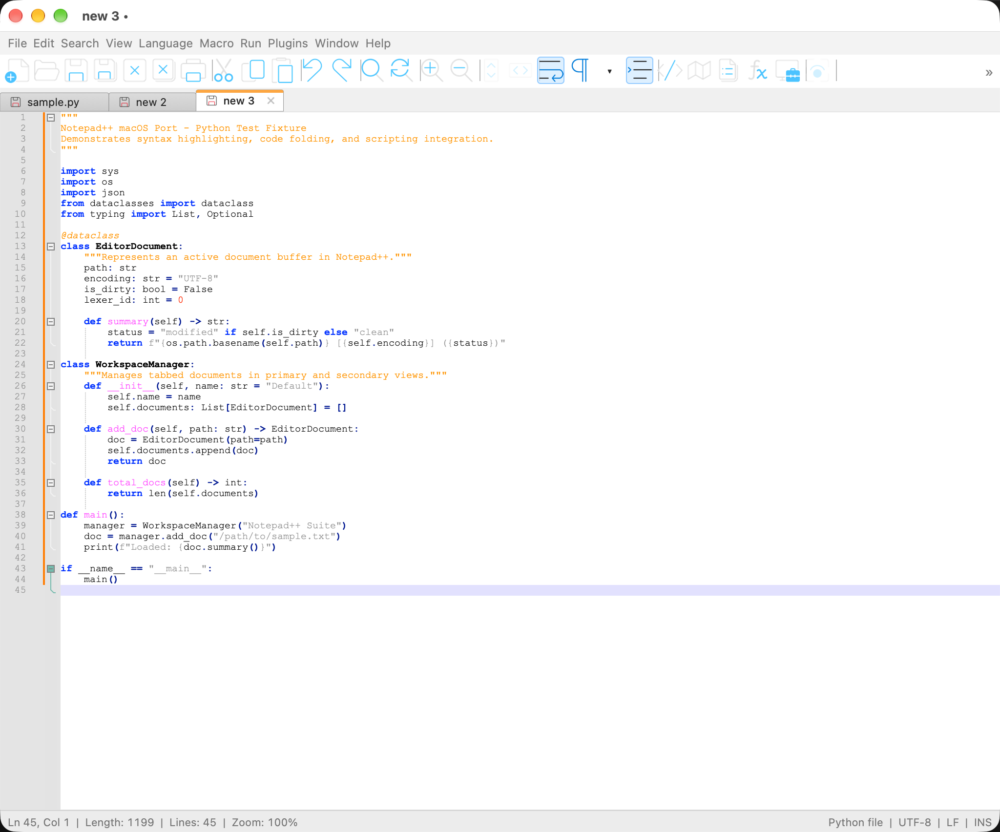
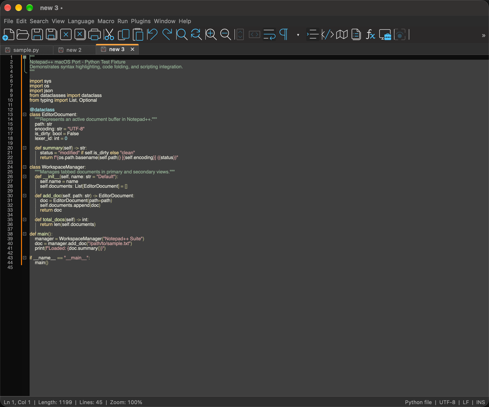

# NP++ for macOS

NP++ is a native macOS port of Notepad++, written in Objective-C++ with AppKit and the
vendored Scintilla and Lexilla editing components. It runs as a standard Mac app with
native menus, toolbars, file dialogs, and light and dark appearance.

## Screenshots

<p align="center">
  
  
  <br><em>Light mode (left) and dark mode (right)</em>
</p>

## Window layout

From top to bottom, the main window has:

- **Menu row:** File, Edit, Search and the other document menus. The macOS menu bar keeps only the NP++ app menu.
- **Toolbar row:** the editing and view buttons. When the window is narrow, buttons that don't fit move behind the » button, which opens a vertical list of their icons.
- **Tabs and editor:** open documents, with the editor below them and the status bar at the bottom.

Keyboard shortcuts work the same as before.

## Requirements

- macOS 11 (Big Sur) or later
- Xcode command-line tools (`xcode-select --install`)
- CMake 3.20 or later

## Build the app

```bash
cmake -S . -B build -DCMAKE_BUILD_TYPE=Release
cmake --build build --config Release --parallel
open build/NP++.app
```

The app is built as a universal binary (arm64 and x86_64).

## Run the tests

The XCTest suite covers file loading and saving across encodings (UTF-8 with and without
BOM, UTF-16 LE and BE, Windows-1252, empty files), save state after edits and failed saves,
and the lossy-encoding warning for saves and conversions.

```bash
cmake -S . -B build-tests -DNPP_BUILD_TESTS=ON
cmake --build build-tests --target NppEncodingTests --parallel
xcrun xctest build-tests/NppEncodingTests.xctest
```

Continuous integration runs the same steps on every push to `master` and on pull requests
(see `.github/workflows/macos.yml`).

## Project layout

- `src/` — application code (windows, controllers, editor view, plugins, theming)
- `resources/` — icons, XML configuration (languages, styles, shortcuts), localization
- `scintilla/`, `lexilla/`, `regex/` — vendored editing, lexing, and regex components
- `tests/` — XCTest sources
- `test_plugins/` — sample plugin used during development

## Icon

The app icon is `resources/npp.icns`, generated from a 1024×1024 master.

## License

GPL-3.0. See [LICENSE](LICENSE).
